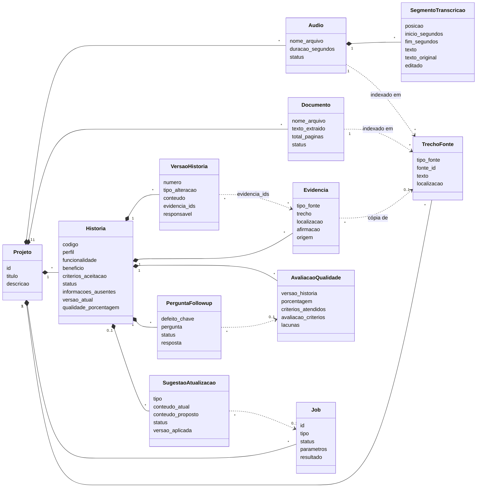

# Arquitetura — ReqScriba Backend v1

## 1. Visão da arquitetura

Monólito modular em camadas, local por padrão, orientado a um fluxo Human-in-the-Loop:

```
           ┌───────── Clientes (frontend em projeto separado, Postman, scripts) ─────────┐
                                         │ HTTP/JSON
┌─────────────────────────────────────── FastAPI ─────────────────────────────────────────┐
│  api/routers  →  schemas (Pydantic)  →  api/deps (Container, UnitOfWork, X-Usuario)       │
├─────────────────────────────────────── services ────────────────────────────────────────┤
│ projects · audios · documents · indexing · retrieval · generation · stories · versioning │
│ evidence · quality · questions · updates · jobs · presenters                              │
├──────────────── domain (puro) ───────────────┬──────────── integrations ─────────────────┤
│ qus · story_format · text · chunking · enums │ llm · ollama · openai_compatible            │
│                                              │ embeddings · vector_store · transcriber     │
│                                              │ extractors · storage                        │
├──────────────── repositories (SQL) ──────────┼─────────────────────────────────────────────┤
│ SQLite (data/reqscriba.db)                   │ ChromaDB (data/chroma) · provedor LLM · disco │
└──────────────────────────────────────────────┴─────────────────────────────────────────────┘
  workers/tasks.py — tarefas de background (BackgroundTasks) com UnitOfWork própria
```

## 2. Camadas do sistema

| Camada | Responsabilidade | Pode depender de |
|---|---|---|
| `api` | HTTP: rotas, validação Pydantic, códigos de status, agendamento de tarefas | services, schemas, core |
| `schemas` | Contratos de entrada/saída (OpenAPI) | pydantic |
| `services` | Casos de uso e regras de negócio, orquestração de LLM/RAG, presenters | domain, repositories (via UoW), integrations (via Container), llm |
| `domain` | Regras puras: QUS, formato de HU, similaridade, chunking, enums | nada (stdlib) |
| `llm` | Prompts e normalização das respostas | domain |
| `repositories` | SQL parametrizado; converte linhas ↔ dict (JSON decodificado) | sqlite3 |
| `integrations` | Adaptadores de serviços externos atrás de protocolos | bibliotecas externas |
| `workers` | Execução assíncrona dos casos de uso longos | services, core |
| `core` | Config, erros, container, tempo | stdlib, pydantic |

### 2.1 Diagrama de classes

Classes do código por camada. Integrações externas ficam atrás de protocolos (`<|..`), e o
`Container` injeta a implementação real ou o fake de teste. Parte da lógica de serviços está em
módulos de funções (`indexing`, `retrieval`, `generation`, `evidence`, `versioning`, `presenters`) e
as tarefas de background são funções (`transcribe_audio`, `process_document`, `run_generation`,
`run_update_analysis`).

```mermaid
classDiagram
    direction TB

    %% ---------- core ----------
    class Settings {
        +llm_provider
        +llm_model
        +embeddings_provider
        +embedding_model
        +whisper_model
        +db_path()
        +chroma_dir()
        +upload_dir()
        +ensure_dirs()
    }
    class Container {
        +settings: Settings
        +db: Database
        +storage: FileStorage
        +llm: LLMClient
        +embedder: Embedder
        +vector_store: VectorStore
        +transcriber: Transcriber
        +uow() UnitOfWork
    }
    class AppError {
        +codigo
        +mensagem
        +detalhes
        +to_dict()
    }
    AppError <|-- NotFoundError
    AppError <|-- BusinessValidationError
    AppError <|-- ConflictError
    AppError <|-- ExternalServiceError

    %% ---------- db / repositories ----------
    class Database {
        +connect()
        +initialize()
        +ping()
    }
    class UnitOfWork {
        +projects, audios, segments, documents, chunks
        +stories, versions, evidences
        +evaluations, questions, suggestions, jobs
        +commit()
        +rollback()
        +close()
    }
    class BaseRepository {
        +insert(values) int
        +update(id, values)
        +get(id) dict
        +delete(id)
    }
    BaseRepository <|-- ProjectRepository
    BaseRepository <|-- AudioRepository
    BaseRepository <|-- SegmentRepository
    BaseRepository <|-- DocumentRepository
    BaseRepository <|-- SourceChunkRepository
    BaseRepository <|-- StoryRepository
    BaseRepository <|-- VersionRepository
    BaseRepository <|-- EvidenceRepository
    BaseRepository <|-- EvaluationRepository
    BaseRepository <|-- QuestionRepository
    BaseRepository <|-- UpdateSuggestionRepository
    BaseRepository <|-- JobRepository
    UnitOfWork *-- BaseRepository : 12 repositórios
    UnitOfWork --> Database

    %% ---------- integrations ----------
    class LLMClient {
        <<protocol>>
        +generate_json(system, prompt) dict
        +health()
    }
    class Embedder {
        <<protocol>>
        +embed(texts) list
        +health()
    }
    class VectorStore {
        <<protocol>>
        +upsert()
        +delete()
        +delete_where()
        +query(embedding, top_k, where)
        +health()
    }
    class Transcriber {
        <<protocol>>
        +transcribe(path) TranscriptionResult
        +health()
    }
    class OllamaClient {
        +generate_json()
        +embed()
        +health()
        +embedding_health()
    }
    class OpenAICompatibleClient {
        +generate_json()
        +embed()
        +health()
        +embedding_health()
    }
    class FileStorage {
        +save()
        +resolve()
        +remove()
    }
    LLMClient <|.. OllamaClient
    LLMClient <|.. OpenAICompatibleClient
    Embedder <|.. RemoteEmbedder
    Embedder <|.. HashEmbedder
    RemoteEmbedder --> OllamaClient : /api/embed
    RemoteEmbedder --> OpenAICompatibleClient : /embeddings
    VectorStore <|.. ChromaVectorStore
    VectorStore <|.. InMemoryVectorStore
    Transcriber <|.. FasterWhisperTranscriber
    FasterWhisperTranscriber ..> TranscriptionResult
    TranscriptionResult *-- TranscribedSegment

    Container --> Settings
    Container --> Database
    Container --> FileStorage
    Container --> LLMClient
    Container --> Embedder
    Container --> VectorStore
    Container --> Transcriber

    %% ---------- services ----------
    class ProjectService
    class AudioService
    class DocumentService
    class StoryService
    class QualityService
    class QuestionService
    class UpdateService
    class JobService
    class ServiceModules {
        <<módulos de funções>>
        indexing / retrieval
        generation / evidence
        versioning / presenters
    }
    ProjectService --> UnitOfWork
    AudioService --> UnitOfWork
    AudioService --> Container
    DocumentService --> Container
    StoryService --> UnitOfWork
    QualityService --> Container
    QuestionService --> Container
    UpdateService --> Container
    JobService --> UnitOfWork
    AudioService ..> ServiceModules
    DocumentService ..> ServiceModules
    UpdateService ..> ServiceModules
    ServiceModules ..> AppError : lança
```



## 3. Separação entre UI, estado, domínio e persistência

- **UI:** fora deste repositório. O frontend é um projeto separado, em outra origem, e se conecta pelo
  contrato da API (OpenAPI + `docs/ux-guidelines.md`): rótulos legíveis (`status_rotulo`), estados
  explícitos, URLs de mídia com marcação de tempo, listas no padrão `{"itens","total"}`.
- **Estado:** o estado do fluxo vive no banco, nunca em memória do processo: status de fontes,
  jobs, HU, perguntas e sugestões. Isso permite reiniciar a API sem perder nada e consultar
  progresso por polling.
- **Domínio:** `app/domain` concentra o que é regra verificável sem I/O (QUS, template de HU,
  similaridade, chunking). Os serviços combinam domínio + persistência + IA.
- **Persistência:** SQLite é a fonte de verdade; ChromaDB é índice derivado e reconstruível a partir
  de `trechos_fonte`; arquivos em disco são referenciados por caminho.

### 3.1 Modelo de domínio

As entidades não são classes Python: são tabelas de `app/db/schema.sql`, manipuladas como `dict`
pelos repositórios. Linha cheia com losango (`*--`) = chave estrangeira com `ON DELETE CASCADE`;
linha tracejada (`..>`) = referência lógica sem FK (`trecho_id`, `evidencia_ids`, `fonte_id`
polimórfico para áudio ou documento). Cada `TrechoFonte` tem um vetor correspondente no ChromaDB.



## 4. Fluxos principais

**Ingestão de áudio:** upload → validação → disco + linha `pendente` → `202` → tarefa: `processando`
→ Whisper → segmentos → janelas (`trechos_fonte`) → embeddings → Chroma → `concluido` (ou `erro`).

**Correção de transcrição:** `PATCH segmento` → texto revisado salvo (original preservado) → janelas do
áudio reconstruídas e reindexadas (o mesmo texto revisado alimenta as próximas extrações).

**Geração de HU:** job → valida fontes → monta lotes (transcrição + RAG de documentos; documentos
restantes) → LLM por lote → normalização → deduplicação → HU + evidências + versão 1 → job `concluido`.

**Avaliação QUS:** HU + backlog → LLM (8 individuais) + LLM (conjunto) + regras determinísticas → avaliação
persistida (histórico) → cache de qualidade na HU.

**Atualização iterativa:** job com novas fontes → para cada HU: RAG restrito às novas fontes → LLM de
impacto → sugestões `complementa/contradiz`; trechos não citados → extração → `novo_requisito` → humano
aprova/edita/rejeita → aplicação gera nova versão + evidências `atualizacao`.

## 5. Decisões técnicas

| # | Decisão | Motivo |
|---|---|---|
| D1 | `sqlite3` da stdlib + repositórios próprios em vez de ORM | Menos dependências, SQL explícito e fácil de auditar; o volume de entidades é pequeno. Repositórios isolam a troca futura por PostgreSQL. |
| D2 | Código em inglês, dados em português | Elimina camadas de mapeamento; contrato JSON fiel ao vocabulário do domínio. |
| D3 | `BackgroundTasks` do FastAPI + tabela `jobs` | Assíncrono sem broker. Estado persistido permite polling e reprocessamento. |
| D4 | Embeddings calculados pelo backend (Ollama `bge-m3`) e enviados ao Chroma | Mantém a stack sem `sentence-transformers`/PyTorch; `bge-m3` é multilíngue (PT-BR). Configurável. |
| D5 | LLM cita rótulos `F1..Fn`; evidência copiada do banco | Rastreabilidade confiável e sem alucinação de trechos com um modelo pequeno (4B parâmetros). |
| D6 | Avaliação QUS híbrida (LLM + regras determinísticas) | Critérios verificáveis (well_formed, unique, uniform) ficam estáveis; o LLM cobre os semânticos. |
| D7 | Versões com snapshot completo + lista de evidências | Consulta de qualquer versão em O(1); rastreabilidade por versão (US-18) trivial. |
| D8 | Evidências imutáveis | Histórico confiável; correções de fonte não reescrevem o passado. |
| D9 | `faster-whisper` opcional | Pesado (CTranslate2); a API funciona sem ele e o áudio vai para `erro` com instrução clara. |
| D10 | `format: "json"` + validação + 1 retentativa | Modelos pequenos às vezes fogem do formato; normalização tolera variações de chave/valor. |
| D11 | Geração em lotes de ~6000 caracteres | Cabe no `num_ctx` 8192 do modelo junto com instruções e resposta. |
| D12 | `X-Usuario` opcional como responsável | Atende US-19 CA03 sem autenticação e prepara a integração futura. |
| D13 | Decodificação de áudio própria (`decode_audio` em `integrations/transcriber.py`) | O `faster-whisper` 1.2.1 decodifica com `av.open(..., metadata_errors="ignore")`, argumento removido no PyAV recente (18+), e toda transcrição falha. Decodificamos com PyAV para float32 mono 16 kHz e passamos o array ao modelo: funciona com qualquer versão do PyAV, sem fixar dependência. |
| D14 | LLM `qwen3.5:4b` com `think: false` fixo no payload de `/api/chat` | O modelo vem com *thinking* ligado por padrão; em teste local com `format: json`, gerou 1022 tokens com ele e 66 sem, para um JSON equivalente. Nenhum fluxo usa o raciocínio, e o volume em lotes arriscaria estourar timeout e `num_ctx`. Sem variável de ambiente nova (opção mais simples); `think: false` é aceito também pelo `llama3.2:3b`, então o rollback é só trocar `REQSCRIBA_LLM_MODEL`. |
| D15 | Frontend em projeto separado: URLs `url_*` relativas e erro 500 tratado dentro do CORS | O cliente prefixa as URLs com a origem da API (`docs/ux-guidelines.md` §8), a opção mais simples, sem nova variável de ambiente. O handler de `Exception` roda no `ServerErrorMiddleware`, fora do `CORSMiddleware`; um middleware interno gera o 500 para que ele tenha cabeçalhos CORS, senão o navegador esconderia o erro do frontend. |
| D16 | Agnóstico de LLM: protocolos + adaptadores próprios com `requests` (`ollama` e `openai_compatible`), sem SDKs nem LiteLLM | Os serviços só conhecem `LLMClient` e `Embedder`. Um único adaptador compatível com OpenAI cobre vários servidores locais e em nuvem, sem dependência nova. LLM e embeddings são escolhidos separadamente, e o Ollama continua como padrão. Provedores com API própria entram como novo adaptador, em `_build_client` (`core/container.py`). |
| D17 | Uma coleção do Chroma por modelo de embeddings + `make reindex` | Vetores de modelos diferentes não são comparáveis: misturá-los causa erro de dimensão ou, pior, busca ruim sem aviso. Coleções separadas impedem a mistura, e `/health` sinaliza trechos sem vetor. Coleções antigas ficam em disco, o que permite voltar ao modelo anterior sem recalcular (apenas fontes novas ficariam de fora). |

**Dependências e justificativas:** `fastapi`/`uvicorn` (API), `python-multipart` (upload),
`requests` (provedores de LLM e embeddings, exigido), `chromadb` (vetores, exigido), `pypdf` e `python-docx` (extração
leve, puro Python), `python-dotenv` (carregar `.env`), `faster-whisper` (opcional), `pytest`/`httpx` (dev).

## 6. Trade-offs

| Escolha | Ganho | Custo / mitigação |
|---|---|---|
| SQLite | Zero configuração, arquivo único | Concorrência de escrita limitada → WAL + `busy_timeout`; migração para PostgreSQL via repositórios. |
| BackgroundTasks | Simples, sem infraestrutura | Tarefas rodam no processo da API e se perdem se ele cair → status persistido + reprocessar. |
| Qwen 3.5 4B local | Privacidade, custo zero | Qualidade menor que modelos grandes → prompts curtos, JSON validado, regras determinísticas, humano no loop. |
| Sem ORM | Menos abstração | Mais SQL manual → repositórios pequenos e testados. |
| Lotes + deduplicação | Escala com o tamanho das fontes | Pode separar uma necessidade entre lotes → deduplicação por similaridade mescla. |
| Busca textual normalizada em Python | Ignora acentos/maiúsculas (PT-BR) | Varre os segmentos de um áudio (volume pequeno); sem ranking → busca semântica separada em `/busca`. |

## 7. API

Base: `http://localhost:8000/api/v1` · OpenAPI interativa em `/docs` (Swagger) e `/redoc`.
Cabeçalho opcional `X-Usuario` (responsável pelas alterações; padrão `engenheiro`).

### Saúde
| Método | Rota | Descrição |
|---|---|---|
| GET | `/health` | Status de SQLite, ChromaDB (e reindexação pendente), LLM, embeddings e ASR |

### Projetos
| Método | Rota | Descrição |
|---|---|---|
| POST | `/projetos` | Criar projeto |
| GET | `/projetos` | Listar projetos (com totais e qualidade geral) |
| GET | `/projetos/{projeto_id}` | Detalhar projeto + backlog |
| PATCH | `/projetos/{projeto_id}` | Atualizar título/descrição |
| DELETE | `/projetos/{projeto_id}` | Excluir projeto e todos os dados |

### Áudios e transcrição (US-01..03, US-13)
| Método | Rota | Descrição |
|---|---|---|
| POST | `/projetos/{projeto_id}/audios` | Upload (`multipart`, campo `arquivo`) → `202` |
| GET | `/projetos/{projeto_id}/audios` | Listar áudios do projeto |
| GET | `/audios/{audio_id}` | Detalhes e estado |
| GET | `/audios/{audio_id}/arquivo` | Arquivo de áudio (suporta `Range`, use `#t=` para posicionar) |
| POST | `/audios/{audio_id}/reprocessar` | Nova tentativa de transcrição |
| GET | `/audios/{audio_id}/transcricao` | Transcrição completa + segmentos com tempos |
| GET | `/audios/{audio_id}/transcricao/busca?termo=` | Busca textual nos segmentos |
| PATCH | `/audios/{audio_id}/segmentos/{segmento_id}` | Corrigir texto de um segmento |
| DELETE | `/audios/{audio_id}` | Excluir áudio |

### Documentos (US-04, US-13)
| Método | Rota | Descrição |
|---|---|---|
| POST | `/projetos/{projeto_id}/documentos` | Upload PDF/DOCX/TXT/MD → `202` |
| GET | `/projetos/{projeto_id}/documentos` | Listar documentos |
| GET | `/documentos/{documento_id}` | Detalhes e estado |
| GET | `/documentos/{documento_id}/conteudo` | Texto extraído + trechos indexados |
| POST | `/documentos/{documento_id}/reprocessar` | Nova tentativa de extração/indexação |
| DELETE | `/documentos/{documento_id}` | Excluir documento |

### Busca semântica
| Método | Rota | Descrição |
|---|---|---|
| GET | `/projetos/{projeto_id}/busca?termo=&limite=` | RAG sobre trechos de áudios e documentos |

### Histórias de Usuário (US-05, 06, 16–20)
| Método | Rota | Descrição |
|---|---|---|
| POST | `/projetos/{projeto_id}/historias/gerar` | Gerar HU a partir de `audio_ids`/`documento_ids` → `202` job |
| POST | `/projetos/{projeto_id}/historias` | Criar HU manualmente |
| GET | `/projetos/{projeto_id}/historias?status=` | Listar HU |
| GET | `/historias/{historia_id}` | Detalhe completo (QUS, fontes, versões) |
| PATCH | `/historias/{historia_id}` | Editar campos (gera nova versão) |
| POST | `/historias/{historia_id}/aprovar` | Aprovar |
| POST | `/historias/{historia_id}/desaprovar` | Desaprovar (sai do backlog) |
| GET | `/historias/{historia_id}/evidencias?versao=` | Evidências (atuais ou de uma versão) |
| GET | `/historias/{historia_id}/rastreabilidade` | Evidências por versão, com navegação |
| GET | `/historias/{historia_id}/versoes` | Histórico cronológico |
| GET | `/historias/{historia_id}/versoes/{numero}` | Conteúdo de uma versão |

### Qualidade (US-07..09)
| Método | Rota | Descrição |
|---|---|---|
| POST | `/historias/{historia_id}/avaliar` | Avaliar/reavaliar versão atual (QUS) |
| GET | `/historias/{historia_id}/avaliacoes` | Histórico de avaliações |
| GET | `/historias/{historia_id}/avaliacoes/comparacao?de=&para=` | Comparar duas avaliações |
| GET | `/historias/{historia_id}/defeitos` | Defeitos e lacunas atuais |
| GET | `/projetos/{projeto_id}/qualidade` | Visão geral de qualidade do projeto |

### Perguntas de follow-up (US-10..12)
| Método | Rota | Descrição |
|---|---|---|
| POST | `/historias/{historia_id}/perguntas/gerar` | Gerar perguntas (opcional: `defeitos`) |
| GET | `/projetos/{projeto_id}/perguntas?status=&historia_id=` | Listar perguntas |
| GET | `/projetos/{projeto_id}/followup?agrupar_por=historia\|tipo_defeito` | Lista de follow-up agrupada |
| PATCH | `/perguntas/{pergunta_id}` | Editar texto |
| POST | `/perguntas/{pergunta_id}/aprovar` | Aprovar |
| POST | `/perguntas/{pergunta_id}/rejeitar` | Rejeitar |
| POST | `/perguntas/{pergunta_id}/responder` | Registrar resposta |

### Atualizações iterativas (US-13..15)
| Método | Rota | Descrição |
|---|---|---|
| POST | `/projetos/{projeto_id}/atualizacoes/analisar` | Analisar novas fontes → `202` job |
| GET | `/projetos/{projeto_id}/sugestoes-atualizacao?status=` | Listar sugestões |
| GET | `/sugestoes-atualizacao/{sugestao_id}` | Detalhe com comparação atual × proposto |
| PATCH | `/sugestoes-atualizacao/{sugestao_id}` | Editar conteúdo proposto |
| POST | `/sugestoes-atualizacao/{sugestao_id}/aprovar` | Aprovar e aplicar (aceita edição final) |
| POST | `/sugestoes-atualizacao/{sugestao_id}/rejeitar` | Rejeitar (HU preservada) |

### Jobs
| Método | Rota | Descrição |
|---|---|---|
| GET | `/jobs/{job_id}` | Estado e resultado de um job |
| GET | `/projetos/{projeto_id}/jobs` | Jobs do projeto |
